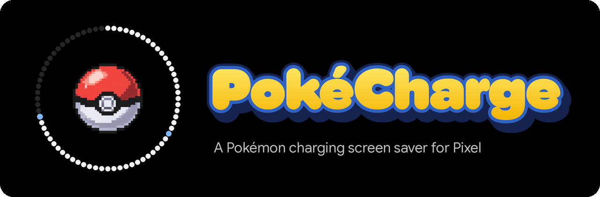
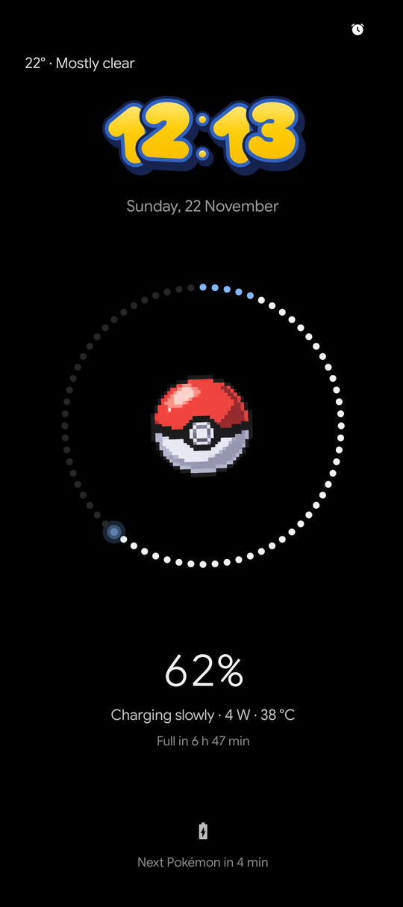
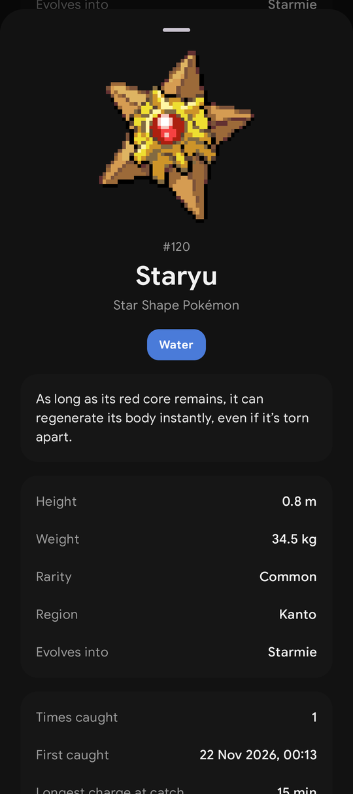
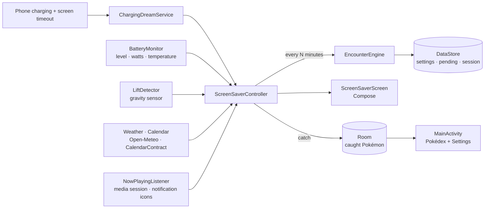

<div align="center">



# PokéCharge

**A Glyph-style charging screen saver for Pixel with a Pokémon catching game: plug in, watch the dot ring fill, catch what shows up.**

[](https://github.com/arunkmr13/PokeCharge/actions/workflows/build.yml)
[](https://github.com/arunkmr13/PokeCharge/releases)
[](LICENSE)


[Features](#features) · [Screenshots](#screenshots) · [Getting started](#getting-started) · [Usage](#usage) · [How it works](#how-it-works) · [Contributing](#contributing)

</div>

---

## About

PokéCharge is an Android screen saver (a `DreamService`) that runs only while your phone is charging. A ring of dots, inspired by the Nothing Glyph Matrix, fills with the charge level on a pure-black OLED background. A wild Pokémon turns up as soon as you plug in, and a new one every 10 minutes after that. Tap to catch it, and it goes into your Pokédex.

Around the clock it shows the weather, your next calendar event, charging power and temperature, what's playing, and which apps have notifications.

It plugs into Android's built-in screen saver setting, so it starts by itself when you plug in. It needs no background service, no root and no battery-optimisation workarounds.

> [!NOTE]
> Personal fan project, built for and tested on a Pixel 10. Not affiliated with or endorsed by Nintendo, The Pokémon Company or Game Freak.

## Features

### Screen saver
- [x] **Charging only.** Starts when the phone is charging and the screen times out, and stops when you unplug.
- [x] **Dot ring.** One circle of 72 dots fills clockwise with the battery level. The leading dot glows in your accent colour and breathes slowly, and a soft pulse walks the lit dots one at a time.
- [x] **Three clock styles.** *Google Sans* (large and light), *Poké* (chunky yellow digits with a blue outline and an extruded shadow) or *Dot matrix*. The clock follows the phone's 12/24-hour setting.
- [x] **Wake on gesture.** The screen stays black (OLED pixels off) until you **tap** or **lift** the phone, then fades out after 10, 15 or 30 s. You can also choose **Always on**.
- [x] **Glanceable info,** each with its own switch:
  - Weather on the date line ([Open-Meteo](https://open-meteo.com/), from your approximate location)
  - Next calendar event in the coming 24 hours
  - Charging speed in watts and battery temperature, with time to full
  - Now playing (track, artist and app)
  - Icons of apps with notifications, above the player (icons only, never message text)
- [x] **Burn-in protection.** The layout drifts by a couple of pixels each minute, gliding there over a few seconds.

### Game
- [x] **Encounters on a rhythm.** A Pokémon is waiting as soon as you plug in, and a new one arrives every 5, 10, 15 or 30 minutes (10 by default), caught or not. One you leave uncaught runs off when the next arrives.
- [x] **A wobbling ball** sits in the ring while the next Pokémon is on its way: three quick shakes, then a pause.
- [x] **Rarity that rewards long charges.** Common Pokémon are common. The odds flatten on long, overnight charges, legendaries and mythicals are extra rare, and any Pokémon can be **shiny** (1 in 512).
- [x] **Pokédex.** *Caught / All / Missing* filters, newest catches first, with silhouettes for the ones still missing.
- [x] **Details for every catch.** Tap a caught Pokémon for its Pokédex entry, category, types, height, weight, rarity, region, evolutions, and your own history with it (times caught, shinies, first and last catch, longest charge).
- [x] **Region pool.** Limit encounters to Kanto (151), Johto, Hoenn, Sinnoh or Unova (649).

### App
- [x] **Light, dark or system theme** for the app. The screen saver always stays black.
- [x] **Four accent colours,** set in Google Sans Flex throughout.
- [x] **Permission card** in Settings that explains what each info item needs, with fallbacks when Android stops showing the prompt.
- [x] **Built-in testing.** Preview the screen saver and spawn a test encounter from the app, without waiting for a charge.

### Planned
- [ ] Home-screen widget and Quick Settings tile
- [ ] Charge-progress Live Update notification

## Screenshots

<!-- Capture on the phone with: adb exec-out screencap -p > docs/screenshots/charging.png -->

| Charging | Encounter | Caught |
|:---:|:---:|:---:|
|  |  |  |

| Pokédex | Details | Settings |
|:---:|:---:|:---:|
|  |  |  |

## Getting started

### Requirements

| | |
|---|---|
| Device | Android 15 (API 35) or later. Built for Pixel phones, which have the Screen saver setting |
| Build | Android Studio (latest stable), JDK 17 |

### Install on your phone

1. On the phone, open [Releases](https://github.com/arunkmr13/PokeCharge/releases/latest) and tap `PokeCharge-*.apk`.
2. Tap the downloaded file. Allow installs from your browser when Android asks, then tap **Install**. If Play Protect warns about an unknown app, tap **Install anyway**.
3. Open PokéCharge once while online. It downloads the Pokémon sprites in the background (about 1,300 small images, a couple of MB); a card in Settings shows the progress.

To update, install the newer APK the same way. Your Pokédex stays.

### Build from source

```bash
git clone https://github.com/arunkmr13/PokeCharge.git
cd PokeCharge
./gradlew installDebug      # with the phone connected over USB or wireless debugging
```

Or open the folder in Android Studio and press **Run**.

### Turn it on

1. On the phone, go to **Settings → Display & touch → Screen saver**. The app's **Open Pixel screen saver settings** button goes straight there.
2. Pick **PokéCharge**.
3. Set **When to show** to **While charging**.
4. Plug in and let the screen time out.

### Allow the info items

In the app, **Settings → On the screen** lists anything still missing, each with an **Allow** button:

| Item | Needs |
|---|---|
| Weather | Approximate location (read while the app is open, then saved) |
| Next calendar event | Calendar |
| Now playing, notification icons | Notification access |

> [!IMPORTANT]
> Android blocks notification access for apps that weren't installed from the Play Store. If the PokéCharge switch is greyed out, open **App info → ⋮ → Allow restricted settings**, then try again.

### Sprites

No sprites are in the repository or the APK. On first launch the app downloads the Black/White sprites from [PokeAPI's sprite collection](https://github.com/PokeAPI/sprites) into its own storage, scaled up without smoothing so the pixel art stays sharp. Pokémon whose sprite hasn't arrived yet show as placeholders.

To skip the download in your own builds, put sprites in the app's assets instead (this folder is in `.gitignore`):

```
app/src/main/assets/sprites/0001.png … 0649.png    # by National Dex number
app/src/main/assets/sprites/shiny/0001.png …
```

## Usage

| On the screen saver | Does |
|---|---|
| Tap | Wake the display, or catch the waiting Pokémon |
| Lift the phone | Wake the display (when *Lift to check* is on) |
| Double-tap or swipe up | Exit to the lock screen |

| In the app | |
|---|---|
| **Pokédex** tab | Caught / All / Missing; tap a caught Pokémon for its details |
| **Settings** tab | Display mode, wake gestures, encounter interval, Pokémon pool, info items, appearance, clock style, accent |
| **Preview the screen saver** | Run it full screen without charging |
| **Spawn a test encounter** | Put a Pokémon in the waiting slot right away |

> [!TIP]
> On a wireless pad, lifting the phone stops charging, which closes the screen saver. Lift to check works best on a cable. Tap works everywhere.

## How it works



A waiting Pokémon and the charge session's running time are saved in DataStore. Briefly waking the phone on the charger restarts the screen saver without losing either. Pokédex entries are downloaded from PokeAPI the first time you open a Pokémon's details, then kept on the phone.

### Project structure

```
app/src/main/java/dev/arun/chargecatch/
├── dream/ChargingDreamService.kt   # The screen saver; hosts the Compose UI
├── ScreenSaverController.kt        # Wake/hide, tap & lift, encounter rhythm, info refresh, catching
├── battery/BatteryMonitor.kt       # Level, plug type, watts, temperature, time to full (Flow)
├── wake/LiftDetector.kt            # Tilt detection from the gravity sensor
├── game/EncounterEngine.kt         # Which Pokémon appears, shiny odds
├── game/Encounters.kt              # Spawning and catching, shared by all entry points
├── info/                           # Weather, calendar, location, notification listener, Pokédex entries
├── sprites/SpriteRepository.kt     # Loads and trims sprites and item images
├── ui/DotMatrix.kt                 # Charge ring, dot glyphs and dot digits
├── ui/ScreenSaverScreen.kt         # The screen saver layout and clocks
├── ui/Type.kt, ui/AppColors.kt     # Google Sans Flex, light and dark palettes
├── data/                           # Species (PokeAPI), Room DB, DataStore settings
├── MainActivity.kt                 # Pokédex, details sheet and settings
└── PreviewActivity.kt              # Full-screen preview for testing
```

### Tech stack

Kotlin · Jetpack Compose (Material 3) · Coroutines and Flow · Room (KSP) · DataStore · kotlinx.serialization · Android `DreamService` · `NotificationListenerService`

## Contributing

Issues and pull requests are welcome. Please open an issue before starting a large change, and read [CONTRIBUTING.md](CONTRIBUTING.md).

## Acknowledgements

- Inspired by the Nothing Glyph Matrix and the community *Glyph Catch* fan game.
- Species data, Pokédex entries and sprites from [PokeAPI](https://pokeapi.co/).
- Weather from [Open-Meteo](https://open-meteo.com/).
- [Google Sans Flex](https://fonts.google.com/specimen/Google+Sans+Flex), under the SIL Open Font License (`app/src/main/assets/licenses/`).

## License

The source code is released under the [MIT License](LICENSE).

Pokémon names, the Poké Ball and related data are trademarks of Nintendo, Creatures Inc. and Game Freak. No sprite files are included in this repository or the APK; the app fetches them from PokeAPI at runtime. This is an unofficial fan project, not affiliated with or endorsed by them.
