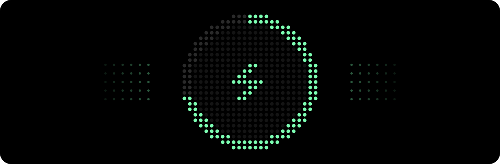
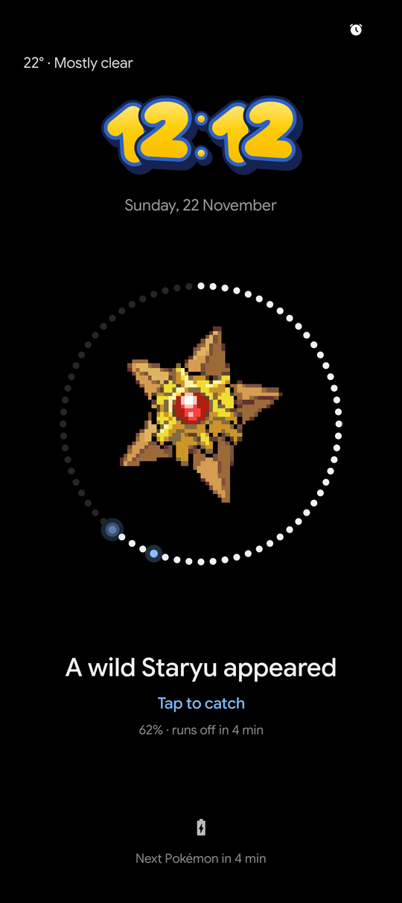
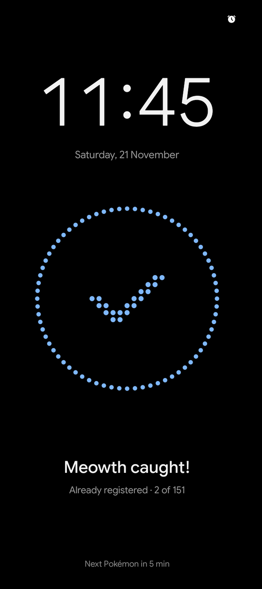
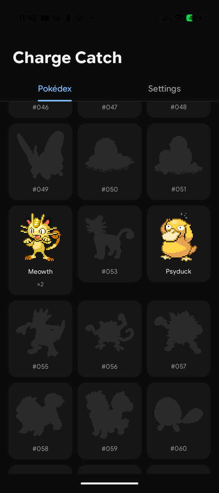
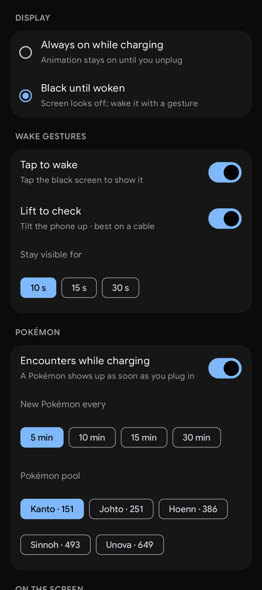
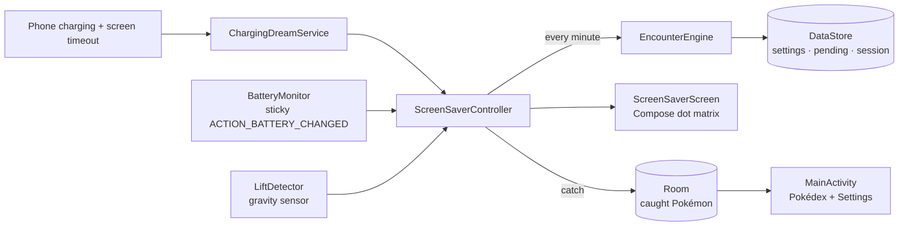

<div align="center">



# Charge Catch

**A Glyph-style charging screen saver for Pixel with a Pokémon catching game: plug in, watch the dot ring fill, catch what shows up.**

[](https://github.com/arunkmr13/ChargeCatch/actions/workflows/build.yml)
[](https://github.com/arunkmr13/ChargeCatch/releases)
[](LICENSE)


[Features](#features) · [Screenshots](#screenshots) · [Getting started](#getting-started) · [How it works](#how-it-works) · [Contributing](#contributing)

</div>

---

## About

Charge Catch is an Android screen saver (a `DreamService`) that runs only while your phone is charging. A round 25×25 dot matrix, inspired by the Nothing Glyph Matrix, shows the charge level on a pure-black OLED background. The longer the phone stays on the charger, the more likely a Pokémon is to appear. Tap to catch it, and it is added to your Pokédex.

It plugs into Android's built-in screen saver setting, so it starts by itself when you plug in. It needs no background service, no root and no battery-optimisation workarounds.

> [!NOTE]
> Personal fan project, built for and tested on a Pixel 10. Not affiliated with or endorsed by Nintendo, The Pokémon Company or Game Freak.

## Features

- [x] **Charging only.** Starts when the phone is charging and the screen times out, and stops when you unplug.
- [x] **Glyph-style dot ring.** A 25×25 dot matrix fills with the battery level, with a dot-matrix clock, date, plug type and time to full.
- [x] **Wake on gesture.** The screen stays black (OLED pixels off) until you **tap** or **lift** the phone, then fades out after 10, 15 or 30 s. You can also choose **Always on**.
- [x] **Encounters.** None for the first 15 minutes, then a rising chance each minute, and a guaranteed encounter at 60 minutes.
- [x] **Rarity that rewards long charges.** Common Pokémon are common. The odds flatten on long, overnight charges, legendaries and mythicals are extra rare, and any Pokémon can be **shiny** (1 in 512).
- [x] **Pokédex.** Caught Pokémon are stored in Room, with registered counts per region.
- [x] **Region pool.** Limit encounters to Kanto (151), Johto, Hoenn, Sinnoh or Unova (649).
- [x] **Accent colours.** Four accent colours for the ring.
- [x] **Burn-in protection.** The whole layout shifts a few pixels every minute.
- [x] **Built-in testing.** Preview the screen saver and spawn a test encounter from the app, without waiting for a charge.
- [ ] Home-screen widget and Quick Settings tile
- [ ] Charge-progress Live Update notification

## Screenshots

<!-- Capture on the phone with: adb exec-out screencap -p > docs/screenshots/charging.png -->

| Charging | Encounter | Caught | Pokédex | Settings |
|:---:|:---:|:---:|:---:|:---:|
|  |  |  |  |  |

## Getting started

### Requirements

| | |
|---|---|
| Device | Android 15 (API 35) or later. Built for Pixel phones, which have the Screen saver setting |
| Build | Android Studio (latest stable), JDK 17 |

### Install a release

1. Download the latest `ChargeCatch-*.apk` from [Releases](https://github.com/arunkmr13/ChargeCatch/releases).
2. Open it on the phone and allow installs from that source.

Release builds don't include sprites (see [Sprites](#sprites)), so Pokémon show as numbered placeholders.

### Build from source

```bash
git clone https://github.com/arunkmr13/ChargeCatch.git
cd ChargeCatch
./gradlew installDebug      # with the phone connected over USB or wireless debugging
```

Or open the folder in Android Studio and press **Run**.

### Turn it on

1. On the phone, go to **Settings → Display & touch → Screen saver**. The app's **Open Pixel screen saver settings** button goes straight there.
2. Pick **Charge Catch**.
3. Set **When to show** to **While charging**.
4. Plug in and let the screen time out.

### Sprites

Sprites are not in the repository. Add your own PNGs, named by National Dex number:

```
app/src/main/assets/sprites/0001.png … 0649.png
app/src/main/assets/sprites/shiny/0001.png …      (optional)
```

The folder is in `.gitignore`. Without sprites the app still runs and draws numbered placeholders.

## Usage

| On the screen saver | Does |
|---|---|
| Tap | Wake the display, or catch the waiting Pokémon |
| Lift the phone | Wake the display (when *Lift to check* is on) |
| Double-tap or swipe up | Exit to the lock screen |

| In the app | |
|---|---|
| **Pokédex** tab | Everything you've caught, with counts |
| **Settings** tab | Display mode, tap to wake, lift to check, how long it stays visible, accent, encounters on/off, Pokémon pool |
| **Preview the screen saver** | Run it full screen without charging |
| **Spawn a test encounter** | Put a Pokémon in the waiting slot right away |

> [!TIP]
> On a wireless pad, lifting the phone stops charging, which closes the screen saver. Lift to check works best on a cable. Tap works everywhere.

## How it works



A waiting Pokémon and the charge session's running time are saved in DataStore. Briefly waking the phone on the charger restarts the screen saver without losing either.

### Project structure

```
app/src/main/java/dev/arun/chargecatch/
├── dream/ChargingDreamService.kt   # The screen saver; hosts the Compose UI
├── ScreenSaverController.kt        # Wake/hide state, tap & lift, minute ticks, catching
├── battery/BatteryMonitor.kt       # Level, plug type, time to full (Flow)
├── wake/LiftDetector.kt            # Tilt detection from the gravity sensor
├── game/EncounterEngine.kt         # When a Pokémon appears, which one, shiny odds
├── game/Encounters.kt              # Spawning and catching, shared by all entry points
├── sprites/SpriteRepository.kt     # Loads and trims sprites, drawn pixel-sharp
├── ui/DotMatrix.kt                 # 25×25 dot ring, glyphs and dot digits
├── ui/ScreenSaverScreen.kt         # The screen saver layout
├── data/                           # Species (PokeAPI), Room DB, DataStore settings
├── MainActivity.kt                 # Pokédex and settings
└── PreviewActivity.kt              # Full-screen preview for testing
```

### Tech stack

Kotlin · Jetpack Compose (Material 3) · Coroutines and Flow · Room (KSP) · DataStore · kotlinx.serialization · Android `DreamService`

## Contributing

Issues and pull requests are welcome. Please open an issue before starting a large change, and read [CONTRIBUTING.md](CONTRIBUTING.md).

## Acknowledgements

- Inspired by the Nothing Glyph Matrix and the community *Glyph Catch* fan game.
- Species data from [PokeAPI](https://pokeapi.co/).

## License

The source code is released under the [MIT License](LICENSE).

Pokémon names and related data are trademarks of Nintendo, Creatures Inc. and Game Freak. No game sprites are included in this repository.
